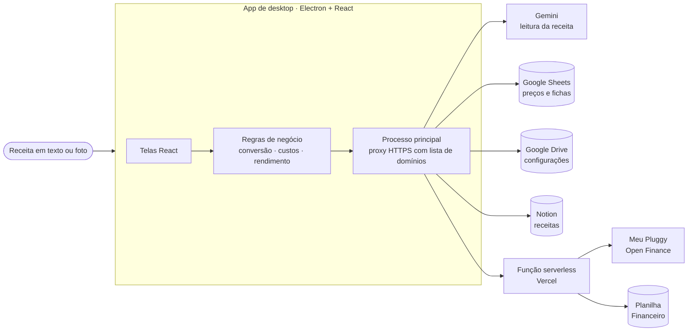

# Marbot Fichas

**App de desktop que automatiza a precificação, as receitas e o financeiro de uma confeitaria real.**


<!-- Para o vídeo tocar aqui: no github.com, edite este README, arraste o docs/demo.mp4 para esta linha e salve. -->
> ▶ **[Assista à demonstração (1 min)](docs/demo.mp4)**

---

## O problema

Criei este app para a **Marbot Ateliê**, a confeitaria da minha namorada. Calcular o preço de cada doce tomava horas: converter "1 xícara" e "1 lata" em gramas, procurar o preço de cada ingrediente, somar embalagem, perda no forno, custos fixos, margem e taxa do cartão — e repetir tudo a cada mudança de preço. As receitas ficavam espalhadas e o controle do dinheiro que entrava e saía era manual.

**O objetivo foi tirar esse tempo e esse estresse do dia a dia:** colar uma receita e receber a ficha de custo pronta, com a receita organizada e o financeiro atualizado sozinho.

## O resultado

- **Precificar uma receita passou de horas para poucos minutos:** cola o texto (ou uma foto), responde 2 ou 3 perguntas e a ficha é gravada na planilha.
- **Está em uso de verdade:** mais de 50 receitas em 7 categorias já foram organizadas com o app.
- **Custo zero para operar:** todas as integrações usam planos gratuitos, e sem internet ou sem IA o app continua funcionando.

## Funcionalidades

**Fichas de custo**
- Lê receitas em texto ou foto com IA e separa os ingredientes por parte (massa, recheios, cobertura).
- Confere cada ingrediente com a planilha de preços; quando não encontra, sugere parecidos, deixa escolher qualquer outro ou cadastrar um novo.
- Converte medidas caseiras e unidades — "150 g de gemas" com ovos cadastrados por unidade vira "≈ 9 ovos", com a conta anotada na ficha.
- Estima o rendimento pelo peso da massa, a perda no cozimento e o tamanho da peça (com um chat para casos especiais).
- Grava a ficha no layout que a confeitaria já usava, com fórmulas vivas: perda, custo fixo, embalagens, margem, taxa do cartão, preço de venda e lucro.
- Navega, edita e apaga fichas, mantendo o Notion sincronizado.

**Receitas no Notion**
- Cada receita vira uma página com ingredientes, modo de preparo e custos, organizada por categoria.

**Financeiro (Open Finance)**
- Conecta as contas bancárias pelo Meu Pluggy e grava o extrato numa planilha.
- Resumo do mês, saldos, gastos por categoria (clicáveis para filtrar), busca e recategorização.
- Mostra quando o banco foi atualizado e quando será a próxima atualização.

**Experiência**
- Modo offline (somente leitura), configurações sincronizadas pela conta Google e modo demonstração.

## Arquitetura



## Decisões técnicas que valem destacar

- **A IA sugere, o código decide.** O Gemini devolve JSON num esquema fixo, mas os números que importam — conversão de unidades, rendimento e custos — são recalculados por funções determinísticas. Uma alucinação da IA não vira preço errado.
- **Funciona sem IA.** Um leitor de receitas próprio (regex + tabela de densidades de ingredientes) produz o mesmo formato da IA. Se a cota gratuita acabar ou a internet cair, o fluxo continua.
- **A planilha continua sendo a fonte da verdade.** As fichas são escritas com fórmulas que apontam para as abas de ingredientes e parâmetros, então mudar um preço na planilha atualiza todas as fichas — sem depender do app.
- **Segurança no Electron.** `contextIsolation` e `sandbox` ligados, sem `nodeIntegration`; a interface não acessa a internet diretamente — tudo passa pelo processo principal, que só aceita HTTPS para uma lista fechada de domínios.
- **Login sem servidor.** OAuth do Google para app de desktop (loopback); as configurações ficam no `appDataFolder` do Drive da própria pessoa, com "a mais recente vence".
- **Segredos fora do app.** As credenciais do Open Finance ficam só nas variáveis secretas da Vercel; a função só responde a quem consegue abrir a planilha Financeiro com a própria conta Google.
- **Offline.** Respostas de leitura ficam em cache local; sem internet, o app abre em modo somente leitura e bloqueia gravações com uma mensagem clara.

## Stack

| Camada | Tecnologias |
| --- | --- |
| Desktop | Electron 45, empacotado com electron-builder (versão portátil para Windows) |
| Interface | React 18, Vite 6, CSS próprio com tema claro |
| IA | Google Gemini (plano gratuito), com Claude como alternativa opcional |
| Dados | Google Sheets API, Google Drive API (appDataFolder), Notion API |
| Financeiro | Meu Pluggy (Open Finance) + função serverless na Vercel (Node.js) |

Cerca de 6 mil linhas de código, sem framework de UI nem backend próprio.

## Como foi construído

Projeto idealizado e desenvolvido por **Vitor Marquez**, usando o **[Claude](https://claude.ai)** (Anthropic) como par de programação. Eu levantei os requisitos com a confeitaria, defini o comportamento de cada tela, testei com receitas e extratos reais e iterei em cima do uso diário; o Claude acelerou a escrita do código e das integrações. Foi um exercício prático de transformar um processo manual em produto, trabalhando com IA de forma orientada.

## Como rodar

Pré-requisitos: [Node.js](https://nodejs.org) 20+ (o app de desktop é gerado para Windows).

```bash
npm install
```

```bash
cp .env.example .env.local
```

Cada variável está explicada no [`.env.example`](.env.example). Nenhuma é obrigatória para conhecer o app: abra e escolha o **modo demonstração**.

```bash
npm run dev
```

```bash
npm run app
```

`npm run dev` abre no navegador; `npm run app` abre o app de desktop; `npm run portable` gera a versão portátil do Windows. O passo a passo das integrações (Google Cloud, Gemini, Notion e a função do financeiro na Vercel) está no [LEIAME.md](LEIAME.md), e as variáveis da função em [`vercel/.env.example`](vercel/.env.example).

## Estrutura

```
src/components/   telas: receita, perguntas, revisão, planilha, financeiro, configurações
src/lib/          regras: leitura da receita, conversões, custos, fórmulas, Sheets, Notion, financeiro
electron/         janela, login com o Google e proxy HTTPS
vercel/api/       função do financeiro (Meu Pluggy → planilha)
site/             páginas de apresentação, política de privacidade e termos
docs/             vídeo de demonstração
```

## Privacidade

O app só lê e grava as planilhas da própria conta Google e a página do Notion escolhida. Chaves e tokens ficam no computador de quem usa ou nas variáveis secretas da Vercel, e nunca vão para este repositório.

---

Feito por **Vitor Marquez** para a **Marbot Ateliê** · [github.com/VitorMarquezz](https://github.com/VitorMarquezz)
